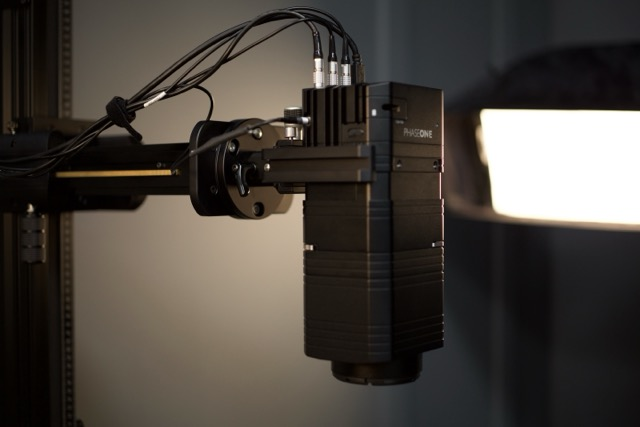

# Digital Imaging Resources

**Digital Imaging Services (DIS)** is the in-house digitization program serving the New York Public Library's three Research Centers: the [Stephen A. Schwarzman Building](https://www.nypl.org/locations/schwarzman), [The New York Public Library for the Performing Arts](https://www.nypl.org/locations/lpa), and the [Schomburg Center for Research in Black Culture](https://www.nypl.org/locations/schomburg). 

Operating out of our primary laboratory in Long Island City and a satellite facility at the Schomburg Center, DIS produces high-quality digital surrogates of rare books, manuscripts, photographs, maps, and archival collections to support global scholarship, preservation, and public access.

While this documentation hub is predominantly focused on DIS in-house laboratory operations, it also serves as the technical repository for **Vendor Digitization Services**, which manages outsourced, large-scale reformatting projects within the broader Digital Reformatting department.

---

## What You Will Find in This Documentation

This site is organized into three primary operational areas, providing programmatic policies, technical specifications, and procedural guidelines for library staff, external partners, and cultural heritage professionals:

### 1. About the Program (In-House Operations)
An overview of the DIS in-house imaging program, including our core mission and laboratory environments.
* **Equipment & Infrastructure:** Detailed inventory of our studio capture systems, Phase One cameras, specialized book cradles, and lighting setups.
* **Software & Systems:** Overview of the capture software, color management tools, and digital asset management pipelines powering our labs.

### 2. Technical Documentation & Standards
The authoritative technical guidelines governing image capture across NYPL research collections.
* **Standards for Digital Images:** Technical specifications defining baseline resolution, bit depth, color space, and FADGI quality targets.
* **Best Practices:** Material-specific capture guides for both **reflective materials** (bound volumes, flat paper, photographic prints) and **transmissive materials** (film negatives, transparencies, glass plate negatives).

### 3. Vendor Digitization (Outsourced Projects)
The operational framework and data schemas required for external digitization partners working with image-based library collections.
* **Scope of Services & Practices:** Institutional guidelines governing material preservation handling, climate-controlled transport logistics, chain of custody, and quality control thresholds.
* **Inventory Spreadsheet:** Schema specifications and controlled vocabularies for building batch manifests and generating item-level JSON sidecars.
* **Digital Asset Specifications:** Baseline technical capture requirements and calibration targets specific to outsourced imaging contracts.

> **Note on Audiovisual Collections:** Documentation for outsourced audio and moving image (AMI) preservation is hosted separately. For time-based media workflows, please consult the dedicated [AMI Preservation — Vendor Digitization](https://nypl.github.io/ami-preservation/pages/preservationServices/vendorDigitization/vendor-digitization-overview.html) site.